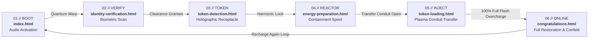

# ⚡ B.O.T.U. – Bhains of the Universe
### Quantum Token Recharge Station | 6-Page Event Activation Experience


-00f59b?style=for-the-badge)


---

## 🌟 Executive Summary

**B.O.T.U. (Bhains of the Universe)** is an elite, cyberpunk-themed interactive web experience engineered for live event activations, digital booth displays, interactive kiosks, and mobile showcases.

The narrative centers on **B.O.T.U.**, a formidable cosmic mecha guardian whose quantum reserves have been depleted. Users embark on a tactile 6-stage sequence—verifying identity, detecting the quantum token cell, spinning up containment reactors, injecting high-energy plasma, and witnessing full system restoration with dynamic audio-visual celebrations.

### Key Highlights
- **100% Zero Runtime Dependencies**: Pure HTML5, modern CSS3, vanilla JavaScript, Canvas 2D, and Web Audio API. No external JS libraries (no React, Vue, Three.js, jQuery, or Howler).
- **Zero Asset Vulnerability**: Contains **0 external image files** and **0 audio files** (`.mp3`/`.wav`). All illustrations are mathematically crafted inline SVGs, and all sound effects are procedurally synthesized in real time via the Web Audio API.
- **Strict Zero-Scrollbar Guarantee**: Tailored with dynamic viewport technology (`100dvh`), `overscroll-behavior: none`, locked headers/footers, and flexible visual stages. Content never clips or triggers scrollbars on screens from **320px mobile up to 4K displays**.
- **High-Loudness Audio Engine**: Built-in multi-stage dynamics compression and dual-stage output booster designed to cut through noisy event halls and convention floors.

---

## 🔄 User Journey & State Architecture

The application is structured as a 6-stage sequential Multi-Page Application (MPA) linked via smooth warp transitions:



---

## 📱 Detailed 6-Page Walkthrough

### 1. `index.html` – System Initialization & Audio Priming
- **Role**: Operator entry gateway and browser audio context unlocking.
- **Visuals**: Standby B.O.T.U. mecha illustration with levitation exhaust flames, idle Arc Reactor chest core, animated laser scanline, and active audio oscilloscope HUD.
- **Interaction**: Prominent `INITIALIZE & START EXPERIENCE` button that unlocks the Web Audio API context in compliance with modern browser autoplay policies, stores the session flag (`sessionStorage.botu_sound_enabled`), plays the deep system boot chime, and initiates the warp transition.

### 2. `identity-verification.html` – Biometric Clearance Gateway
- **Role**: Operator authentication and security clearance.
- **Visuals**: Concentric rotating biometric reticle with sweeping radar sectors, crosshair markers, and an animated laser scanning sweep bar traversing a neural pattern.
- **Audio & Telemetry**: Dynamic procedural scanner sweep sounds and audio blips. Telemetry escalates progressively from `LEVEL-1` up to `LEVEL-4 (OMEGA)` as the counter climbs to 100%.
- **Action**: Unlocks `CONTINUE TO TOKEN SCAN` upon clearance confirmation.

### 3. `token-detection.html` – Holographic Quantum Token Receptacle
- **Role**: Detection, alignment, and authentication of the quantum token coin.
- **Visuals**: Floating 3D holographic token coin with counter-orbiting gyroscope rings and the embossed B.O.T.U. horn insignia.
- **Audio & Telemetry**: Frequency resonance chirps searching for compatible harmonics. Final lock plays a resonant triple-frequency chime and fires canvas spark bursts.
- **Stats**: Confirms 500 Mega-Cores, 99.98% Harmonic Lock, and `AUTHENTICATED` status before enabling reactor preparation.

### 4. `energy-preparation.html` – Fusion Containment & Reactor Spool
- **Role**: Exciting magnetic confinement fields and priming plasma injectors.
- **Visuals**: Dual counter-rotating plasma containment rings with a central pulsating fusion orb, calibration brackets, and canvas electric spark emitters.
- **Audio & Telemetry**: Rising reactor spool whine synthesizer combined with periodic white noise spark crackles. Monitors chamber temperature (`3.2M K`) and magnetic flux (`99.8 kG`).
- **Action**: Unlocks `INITIATE TOKEN TRANSFER` once injector alignment is primed.

### 5. `token-loading.html` – Quantum Energy Injection & Shockwave
- **Role**: High-voltage plasma conduit transfer directly into B.O.T.U.'s Arc Reactor.
- **Visuals**: Full vector mecha illustration. An overhead plasma emitter channels a pulsating cyan energy beam down to B.O.T.U.'s chest. A physical token cell travels down the conduit and dissolves into the reactor.
- **Audio Modulation**: Real-time dual-oscillator charging hum climbing from `110 Hz` to `520 Hz` with bandpass filter sweeping from `320 Hz` to `1420 Hz`.
- **Dynamic Telemetry**: Real-time counter ramping:
  - **Voltage**: `12.4 V` → `480.0 V`
  - **Core Flux**: `180 FLX` → `1000 FLX` (100%)
  - **Capacity**: `0.1 kW/h` → `25.0 kW/h`
- **100% Impact Climax**: Full-screen white flash discharge, expanding radial shockwave ring, sub-bass sonic boom impact, celebratory arpeggio fanfare, and automated warp redirect.

### 6. `congratulations.html` – Victory Fanfare & Fleet Briefing
- **Role**: Mission debriefing and system readiness celebration.
- **Visuals**: Fully restored B.O.T.U. in maximum cosmic brilliance (gleaming eyes, glowing horns, pulsing gyro core) surrounded by a continuous 360° cyber confetti particle explosion.
- **Audio**: Multi-note cosmic victory fanfare arpeggios.
- **Debriefing**: Official gratitude transmission from Cosmic Fleet Command with final telemetry locked at `480.0 V / 100% / 25.0 kW/h`.
- **Action**: `⚡ RECHARGE AGAIN` button providing an uninterrupted event loop back to `index.html`.

---

## 🔊 Sound Engineering: Web Audio API Procedural Synthesizer

Rather than depending on external audio files that risk slow loading, network latency, or codec failures, B.O.T.U. synthesizes **100% of its audio in real time** through the `LoudSoundSynthesizer` class in `botu-core.js`.

### Audio Signal Chain & Loudness Maximization

```text
[ Oscillators / Noise Buffers ]
              │
      [ Biquad Filters ]
              │
       [ Channel Gain ]
              │
      [ Master Gain (2.4x) ]
              │
 [ Dynamics Compressor (-24dB, 16:1) ]
              │
   [ Output Booster Gain (1.85x) ]
              │
     [ audioCtx.destination ]
```

### Synthesizer Capabilities
| Sound Cue | Audio Technique | Audio Characteristics |
| :--- | :--- | :--- |
| **Boot Chime** | Sawtooth sub-sweep + 5-note arpeggio | 55Hz → 180Hz bass drop with triangle harmonics (523Hz – 1318Hz) |
| **Telemetry Blips** | Sine/triangle high-speed ramp | 920Hz → 1380Hz exponential chirp (65ms) |
| **Laser Scanner** | Modulated sawtooth through bandpass filter | 280Hz ↔ 840Hz resonant frequency sweep |
| **Harmonic Lock** | Triple-chord sine ping | 880Hz, 1320Hz, and 1760Hz bell-tone harmonics |
| **Reactor Spool** | Triangle wave with rising lowpass filter | 90Hz → 440Hz spool whine (1.2s ramp) |
| **Continuous Charge** | Dual detuned sawtooth & triangle oscillators | 110Hz & 112.5Hz fundamental pitch ramping to 520Hz in real time |
| **Electric Crackle** | Procedurally filled white noise buffer | Highpass filtered at 1600Hz with exponential decay (45ms) |
| **Sonic Boom** | Sub-bass sine plunge + resonant laser sweep | 160Hz → 32Hz sub drop combined with 260Hz → 1400Hz → 500Hz laser |
| **Celebration Fanfare** | 6-note arpeggio chord + resolution ping | C5 - E5 - G5 - B5 - C6 - E6 chord followed by sustained C-E-G resolution |

> [!TIP]
> The HUD includes an interactive sound toggle (`#hud-sound-toggle`) to quickly mute or unmute audio during live demonstrations.

---

## 🎨 Visual Engine & Zero-Scroll Viewport Technology

To guarantee that the experience functions seamlessly on booth tablets, mobile devices, and large displays without unsightly browser scrollbars or clipped action buttons, the layout adheres to a strict viewport-fit formula:

```css
/* Zero-Scroll Architecture Core */
html, body {
  width: 100%;
  height: 100%;
  height: 100dvh;
  margin: 0;
  padding: 0;
  overflow: hidden !important;
  overscroll-behavior: none;
  position: fixed;
}
```

### Architectural Layout Rules
1. **Dynamic Viewport (`100dvh`)**: Accounts for dynamic browser UI bars on iOS Safari and Android Chrome, preventing content jumping.
2. **Fixed Frame Hierarchy**:
   - **Header & Step Tracker**: `flex-shrink: 0;` (always locked in view)
   - **Footer Action Buttons**: `flex-shrink: 0;` (always clickable without scrolling)
   - **Visual Illustration Stage**: `flex: 1 1 0; min-height: 0; min-width: 0;` (SVGs automatically scale to fill whatever vertical space remains).
3. **Fluid Typography**: Mathematical `clamp()` expressions scale headers, labels, and badges smoothly between compact phones (320px) and wide desktop monitors.
4. **Adaptive Media Queries**:
   - **Compact Devices (≤380px width)**: Trims HUD badges, reduces padding, and condenses step labels.
   - **Ultra-Compact (≤335px width)**: Converts step navigation to minimalist dots and tightens grid columns.
   - **Landscape Mobile (height ≤540px)**: Converts the central stage into a horizontal two-column split so buttons and visuals fit side-by-side.
5. **Real-Time Overflow Validator**: `window.BOTU.checkOverflow()` runs on initialization, page load, window resize, and orientation change. It validates that `docEl.scrollWidth <= docEl.clientWidth` and `docEl.scrollHeight <= docEl.clientHeight`.

---

## ✨ Particle Physics Engine (`ParticleEngine`)

The custom Canvas 2D engine in `botu-core.js` delivers 60 FPS visual feedback:
- **DPR Scaling**: Automatically caps canvas resolution at `Math.min(devicePixelRatio, 2)` to deliver sharp retina visuals while preventing GPU thermal throttling.
- **Charging Sparks**: Directional particles that spawn around coordinates and accelerate inward toward B.O.T.U.'s Arc Reactor core.
- **Celebration Confetti**: Physics-based simulation spawning 130 particles with random drag (`0.965`), gravity (`0.18`), angular spin, variable geometry (rectangles and circles), and vibrant cyber color palettes.

---

## 📂 File Structure & Manifest

```text
B_O_T_U/
├── index.html                   # Phase 01: Welcome, Standby Mecha & Audio Activation
├── identity-verification.html   # Phase 02: Biometric Laser Reticle & Clearance
├── token-detection.html         # Phase 03: Floating 3D Holographic Token Receptacle
├── energy-preparation.html      # Phase 04: Plasma Containment Rings & Reactor Spool
├── token-loading.html           # Phase 05: Quantum Conduit Transfer & Sonic Boom Impact
├── congratulations.html         # Phase 06: Restored Mecha, Fleet Debriefing & Confetti
├── botu-core.js                 # Primary Engine: Synthesizer, Navigation, Particles & Validator
├── style.css                    # Unified Cyberpunk Stylesheet & Zero-Scroll Layout
├── script.js                    # Legacy / Alternate Single-Page Modal Controller
└── README.md                    # Comprehensive System Documentation
```

### Module Differences: `botu-core.js` vs `script.js`
- **`botu-core.js` (Current MPA Core)**: Powers the modern 6-page architecture, coordinating `LoudSoundSynthesizer`, `ParticleEngine`, `BotuNavigator`, HUD controls, and the viewport overflow validator across pages.
- **`script.js` (Legacy Single-Screen Variant)**: Contains `BotuMasterExperience`, an all-in-one single-page controller with an integrated popup modal designed for single-screen implementations.

---

## 🚀 Getting Started & Local Development

Because B.O.T.U. has zero compilation steps and zero third-party dependencies, you can run it immediately with any static file server.

### Option 1: VS Code Live Server
Right-click `index.html` in VS Code and select **Open with Live Server**.

### Option 2: Python HTTP Server
```bash
# In the project root directory:
python -m http.server 8080
```
Open [http://localhost:8080](http://localhost:8080) in your browser.

### Option 3: Node.js `npx serve`
```bash
npx serve .
```

### Option 4: Direct Browser Execution
Double-click `index.html` to open it directly via the `file://` protocol. (All features, SVGs, and audio synthesis function fully offline).

---

## 🖥️ Live Event & Kiosk Deployment

For live installations, conventions, or trade show kiosks, launch Chromium-based browsers (Chrome or Edge) in full-screen kiosk mode with audio gestures enabled:

```bash
# Chrome Kiosk Launch Command (Windows)
chrome.exe --kiosk "http://localhost:8080/index.html" --autoplay-policy=no-user-gesture-required --disable-pinch --overscroll-history-navigation=0
```

```bash
# Microsoft Edge Kiosk Launch Command (Windows)
msedge.exe --kiosk "http://localhost:8080/index.html" --edge-kiosk-type=fullscreen --autoplay-policy=no-user-gesture-required
```

---

## 🛠️ Developer Diagnostics & Testing

Open the browser Developer Tools Console (`F12`) on any page to access the global diagnostic API:

```javascript
// Check Viewport Overflow Status
window.BOTU.checkOverflow();
// Returns: { horizontalOverflow: false, verticalOverflow: false, viewportWidth: ..., viewportHeight: ... }

// Trigger Synthesizer Sound Cues Manually
window.BOTU.sound.playBootSound();
window.BOTU.sound.playLockSound();
window.BOTU.sound.playCompletionSound();
window.BOTU.sound.playCelebrationFanfare();

// Trigger Confetti Burst at Screen Center
window.BOTU.particleEngine.explode(window.innerWidth / 2, window.innerHeight / 2);

// Toggle Global Sound State
window.BOTU.sound.toggleMute();
```

---

## 🎨 Design Tokens & Color Palette

| Token | Hex / Value | Semantic Role |
| :--- | :--- | :--- |
| `--bg-deep` | `#02040a` | Deep space master background |
| `--bg-dark` | `#060b18` | Stage background gradient base |
| `--bg-panel` | `rgba(8, 16, 36, 0.82)` | Glassmorphism HUD and stage cards |
| `--neon-cyan` | `#00f0ff` | Primary energy laser, reticle, and brand accents |
| `--neon-emerald` | `#00f59b` | System online, clearance verified, and success status |
| `--neon-gold` | `#ffb703` | Quantum token coin, capacity stats, warning indicators |
| `--neon-purple` | `#9d4edd` | Cyberpunk aura and mecha horn gradient highlights |
| `--neon-crimson` | `#ff0055` | Critical alerts and high-intensity confetti highlights |

---

## 📄 License & Credits

- **Concept & Direction**: B.O.T.U. (Bhains of the Universe) Quantum Experience.
- **Typography**: Google Fonts ([Orbitron](https://fonts.google.com/specimen/Orbitron), [Rajdhani](https://fonts.google.com/specimen/Rajdhani), [Share Tech Mono](https://fonts.google.com/specimen/Share+Tech+Mono)).
- **Engine Architecture**: Pure Vanilla Web Platform (HTML5 / CSS3 / Web Audio API / Canvas 2D).
